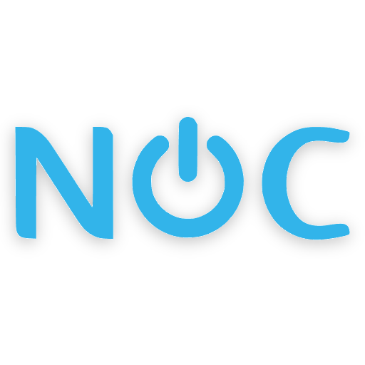

<div align="center">



# NOC — Network Operation Center Virtual

**Panel Layanan Digital Kabupaten Serang**

*Copyright © Dinas Komunikasi, Informatika, Statistik dan Persandian Kabupaten Serang*

</div>

---

## Tentang Aplikasi

**NOC (Network Operation Center Virtual)** merupakan aplikasi panel layanan digital yang dikembangkan oleh Dinas Komunikasi, Informatika, Statistik dan Persandian Kabupaten Serang. Aplikasi ini berfungsi sebagai satu pintu untuk pengkatalogan aset teknologi informasi, pemetaan operasional jaringan, serta dokumentasi teknis dan pelaporan berkala seluruh aset infrastruktur di lingkungan instansi.

Melalui aplikasi ini, pengelola dapat memantau keberadaan dan kondisi aset infrastruktur fisik maupun virtual, mencatat aktivitas operasional, menyusun laporan bulanan, serta mengelola dokumentasi teknis secara terpusat dan terstruktur.

## Fitur Utama

**Aset Infrastruktur**
- Pengelolaan ruang server (*server room*) beserta lokasi penempatan perangkat
- Inventarisasi rak (*rack*) dengan rincian kapasitas dan penempatan
- Pencatatan server fisik lengkap dengan spesifikasi
- Pengelolaan virtualisasi: host Proxmox, mesin virtual (*Virtual Machine*), panel manajemen server, dan perangkat NAS
- Peta topologi jaringan antar lokasi

**Aplikasi & Pengembang**
- Katalog aplikasi yang dikelola, termasuk status produksi
- Pencatatan pihak pengembang dan layanan hosting aplikasi

**Operasional & Pelaporan**
- Catatan aktivitas (*audit log* otomatis dan *work log* manual)
- Penyusunan laporan bulanan dengan dukungan cetak PDF

**Dokumentasi**
- Repositori dokumen teknis dengan pengunduhan yang terlindungi
- Galeri media dokumentasi (foto dan tautan media)

**Manajemen & Administrasi**
- Pengelolaan pengguna, peran (*role*), dan izin akses (*permission*)
- Referensi data instansi
- Halaman pengaturan profil akun
- Tool developer internal (Bcrypt Hash Generator & Verifier)

## Teknologi

| Komponen | Teknologi |
|---|---|
| *Backend framework* | Laravel 12 (PHP ≥ 8.2) |
| Antarmuka reaktif | Livewire 4 (Volt, komponen satu berkas) |
| Otorisasi | Spatie Laravel Permission |
| Antarmuka pengguna | Tailwind CSS v4, IDDS Design System, Tabler Icons |
| Editor teks kaya | Tiptap |
| Penyajian PDF | DomPDF |
| *Bundler* aset | Vite |
| Basis data | MySQL |

## Persyaratan Sistem

- PHP ≥ 8.2 beserta ekstensi: `pdo_mysql`, `gd`, `mbstring`, `dom`, `zip`, `fileinfo`
- Composer ≥ 2.x
- Node.js ≥ 20 dan npm
- MySQL ≥ 8.0 (atau MariaDB yang setara)

## Otorisasi dan Peran

Aplikasi menerapkan otorisasi tingkat modul dengan format penamaan `modul.aksi` (contoh: `servers.create`, `monthly-reports.view-all`) yang dapat dikelola melalui halaman *Role & Permission*.

- **Superadmin** — memiliki akses penuh terhadap seluruh modul.
- **Developer** — peran teknis yang memegang izin modul pengembangan, termasuk `devtools.manage` untuk menuju menu *Developer Tools*.

Menu *Developer* pada sidebar hanya tampil bagi pengguna yang memegang izin `devtools.manage`.

## Keamanan

- **Captcha matematika** pada halaman masuk dengan tantangan sekali pakai (*single-use*) yang kedaluwarsa setelah digunakan.
- **Kebijakan wajib ganti kata sandi**: pengguna baru yang ditandai oleh administrator dipaksa ke halaman penggantian kata sandi pada login pertama; penegakan dilakukan sisi server melalui middleware sehingga tidak dapat dilewati.
- **Regenerasi sesi** setelah autentikasi dan pergantian kata sandi (pencegahan *session fixation*).
- **Aset media terlindungi** — dokumen dan media dilayani melalui rute privat dan tidak dapat diakses publik.
- **Pembatasan perayapan** — berkas `robots.txt` dan meta tag `noindex` mencegah pengindeksan oleh mesin pencari.

## Konvensi Pengembangan

- Komponen antarmuka ditulis dalam format **Livewire Volt satu berkas** di bawah `resources/views/pages/`.
- Seluruh penulisan data dilakukan melalui **Action class** di bawah `app/Actions/`.
- Penataan kode PHP diperiksa menggunakan **Laravel Pint**:

    ```bash
    vendor/bin/pint --dirty
    ```

- Pesan commit mengikuti pola *conventional commits* dalam bahasa Inggris (contoh: `feat(ui): ...`, `fix(admin): ...`).

## Hak Cipta dan Lisensi

Aplikasi ini merupakan milik Dinas Komunikasi, Informatika, Statistik dan Persandian Kabupaten Serang.

**Seluruh hak cipta dilindungi.** Dilarang menyalin, mendistribusikan, atau menggunakan bagian mana pun dari aplikasi ini tanpa izin resmi dari pemilik hak cipta.
